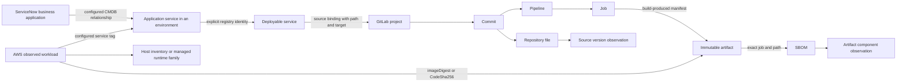

# ServiceNow ↔ GitLab ↔ AWS mapping architecture

This is the implementation reference for the **Mapping workbench**, not a future-only conceptual proposal. The POC now applies configurable ownership/tag profiles to captured API-shaped records, recomputes portfolio attribution, builds a typed evidence graph, exposes records and join evidence in the UI, and exports the same model to JSON and SQLite. All bundled captures are simulated; live collection and production credential/storage services are separate integration work.

## Read the model

1. [Complete logical ERD](erd/01-complete.md), with separate [ownership](erd/02-ownership.md), [delivery](erd/03-delivery.md), [AWS runtime](erd/04-runtime.md), and [version evidence](erd/05-evidence.md) diagrams. Editable Mermaid `.mmd` files are alongside each diagram.
2. [Entity dictionary](entity-dictionary.md): canonical identities, native keys, source scope and semantics for all 26 entity types, plus the [logical field dictionary](logical-field-dictionary.md).
3. [Native field mappings](field-mapping-reference.md): actual ServiceNow, GitLab, AWS, manifest, SBOM and repository fields, transformation, rule and ownership classification.
4. [Relationship rules](relationship-rules.md): every relationship, cardinality, join predicate and error policy.
5. [Adapter profiles](adapter-profiles.md): implemented configuration, alternative customer schemas, shared services, monorepos, conflict handling and code locations.
6. [Official API reference](api-reference.md) and [collection runbook](collection-runbook.md): credentials, requests, collection order, pagination, failure handling and native response boundaries.
7. [Worked traces and acceptance cases](worked-traces.md): inspectable examples including missing SBOMs, contradictory tags, shared consumers and source fallback.
8. [Physical persistence ERD and SQL](physical-model.md): runnable SQLite schema and queries over exported records and evidence.
9. [Coverage and extension matrix](coverage.md): what is implemented, tested, modeled, or still required for another deployment platform.

## Central relationship



A relationship is an evidence assertion, not a name similarity. ServiceNow supplies business/service context, GitLab supplies source/build identity, and AWS supplies observed deployment identity. The build manifest and service registry are explicit integration-owned bridges; no vendor API supplies the complete cross-vendor join automatically.

## Reproduce the model

No npm dependency installation or build step is required. Node >=18 and Python 3 with SQLite JSON support are sufficient.

```bash
npm run demo:generate
npm run docs:generate
npm test
npm run check
node scripts/export-mapping.mjs /tmp/sbom-mapping.json cmdb-relationships
python3 scripts/build-mapping-db.py /tmp/sbom-mapping.json /tmp/sbom-mapping.sqlite
python3 -m http.server 8080 --directory dist
```

Choose fresh output paths for the database; the importer refuses to overwrite an existing file. Open `http://localhost:8080/#mapping`. Inspect the overview, a workload trace, the ERDs, canonical records, field mappings, exceptions and official APIs. Switch the mapping profile and then inspect the Applications, Deployed versions and Environment matrix views: they use the newly resolved mappings for this session.

The browser graph export contains canonical records, relationships, issues and source references. The CLI export additionally includes complete simulated source bundles so the SQLite importer can materialize native evidence. Neither export is a claim that a production API was contacted.

## Source of truth

| Concern | Implementation |
| --- | --- |
| Entity, field, relation, rule and API catalog | `dist/mapping/catalog.mjs` |
| Configurable ownership/service/project/environment resolution | `dist/mapping/resolve.mjs` |
| Observed artifact/build/SBOM correlation and version answers | `dist/enterprise/model.js` |
| Canonical graph and scoped workload traversal | `dist/mapping/model.mjs` |
| Inspectable workbench and diagrams | `dist/mapping/ui.mjs` |
| Native-shaped CMDB/AWS supplementary captures and profiles | `scripts/generate-mapping-demo.mjs`, `dist/data/simulated-mapping-input.json` |
| Source/build/AWS/SBOM baseline captures | `scripts/generate-demo.mjs`, `dist/data/simulated-enterprise.json` |
| Exact-commit repository fallback | `dist/repository/`, `dist/data/simulated-repositories.json` |
| Generated ERDs and reference tables | `scripts/generate-mapping-docs.mjs` |
| Physical persistence/export | `schema/canonical-graph.sql`, `scripts/export-mapping.mjs`, `scripts/build-mapping-db.py` |
| Mutation-based mapping acceptance tests | `mapping-checks.mjs` |

Generated reference files are committed so GitHub can render the diagrams and tables without running the POC. Run `npm run docs:generate` after changing the catalog. Handwritten runbooks explain operational behavior that a table alone cannot capture.
