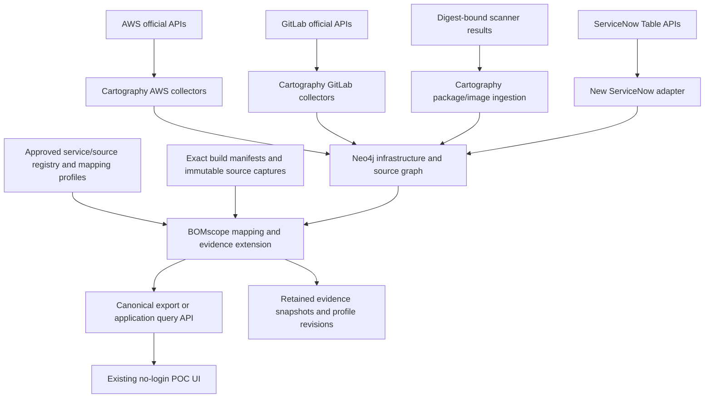

# Cartography assessment and relationship to BOMscope

Reviewed 2026-10-31. Cloned `https://github.com/cartography-cncf/cartography.git` into `/workspace/repos/cartography` using a shallow clone of the default branch. Reviewed commit **2560d4d55794aced5a5815f82147212c0f28a863**. Findings apply to that source revision, which can differ from a published package release. This was a source/design review: no Neo4j instance, external account synchronization, or Cartography integration tests were run. No Cartography code was modified.

## Recommendation

Evaluate Cartography as the live infrastructure/source collection and graph foundation for BOMscope. Preserve BOMscope's ServiceNow application mapping, profile-driven ownership/conflict handling, exact build/artifact correlation, evidence precision and exploratory UI as an extension. Cartography already implements much of the collector and infrastructure-graph work our synthetic POC currently models. It does not provide our complete application/environment/version workflow out of the box.

Do not replace the current POC or change the public site's hosting merely to adopt the graph backend. First prove one complete application-to-workload-to-package trace against a pinned Cartography revision and deterministic fixtures.

## What Cartography supplies

Cartography is a Python ingestion/analysis tool backed by Neo4j. The reviewed package requires Python >=3.11 and declares Apache-2.0 licensing. It has declarative node/relationship schemas, API collectors, managed graph writes, scoped cleanup jobs, update timestamps and post-ingestion analysis. Its README describes broad cloud/SaaS coverage, but inspecting the modules reveals GitLab coverage beyond the README's platform summary.

The standard module flow is `get → transform → load → cleanup → analysis`. Modules and operational dependencies must be selected/configured; cloning the project alone does not populate a graph. The CLI and Neo4j operational model differ substantially from our dependency-free browser-local JavaScript application and optional single-export SQLite store.

## Capability comparison

| Requirement | Cartography at reviewed revision | Relationship to our POC |
| --- | --- | --- |
| AWS inventory and placement | Real collectors for ECS, ECR, EC2, Lambda, SSM, EKS and more | Reuse collectors and native infrastructure relationships rather than implementing them all independently |
| Runtime container → immutable image | ECS container schema records `imageDigest` and matches ECR/GitLab registry images by digest; ontology analysis materializes `RESOLVED_IMAGE`, including platform-aware image resolution | Strong overlap with our observed-workload → artifact relationship; validate identity semantics when exporting into our contract |
| GitLab projects/source metadata | Collectors for groups, projects, branches, users, environments, runners, CI configuration/variables and registry data | Useful live source foundation; these records do not by themselves implement our build-manifest validation chain |
| GitLab dependency SBOMs | Downloads and parses CycloneDX artifacts from selected dependency-scanning jobs | Useful ingestion; selection and stored provenance need extending for deployment-specific answers |
| Manifest discovery | Repository-tree traversal locates known dependency files | Discovery is not equivalent to parsing pinned runtime versions or lockfiles at the deployed commit |
| Image packages and vulnerability evidence | Trivy package/image relationships and a canonical `PackageVersion` ontology; other scanner integrations also exist | Can enrich our inventory, provenance and vulnerability exploration when the scanned digest matches the deployed subject |
| Image → source project | Provenance-based links plus Dockerfile command matching and a low-confidence singleton-Dockerfile fallback | Preserve match method/confidence; heuristic source associations must not become verified build claims |
| ServiceNow business applications/CMDB | No ServiceNow collector found in the reviewed `cartography`, `docs` or `tests` trees | Add a collector/adapter for business apps, application-service CIs, relationship types and customer mappings |
| App/service/project/environment policy | Infrastructure graph does not implement our two ServiceNow ownership profiles and primary-operator decisions | Retain our registry, mappings and conflict behavior, translated into extension schemas/analysis |
| Host-installed runtime/library versions | SSM module collects instance information, patch information and parameters; no `AWS:Application`/`ListInventoryEntries` collector found there | Keep/add the specific installed-application inventory adapter required by our EC2 scope |
| Version threshold questions | Graph stores versions, but the reviewed source does not establish our full conservative comparison/evidence workflow | Retain our version comparator and distinctions among source pins, ranges, runtime families, installed software and artifact inventory |
| No-login exploratory interface | Neo4j is its graph/query foundation; Cartography is not our browser-local portfolio/SBOM viewer | Keep the current UI; introduce a controlled export or application API boundary |
| Persistence/history | Update-tag-based synchronization and stale-data cleanup | Better operational ingestion foundation, but synchronization timestamps are not immutable historical evidence retention |

## Important evidence differences

### Default-branch dependency results are not deployed-build inventory

`cartography/intel/gitlab/dependencies.py:get_dependencies()` selects a recent successful dependency-scanning job, taking a default branch parameter. It downloads by the selected numeric job ID, which is useful, but it does not start from our observed AWS artifact and resolve the exact build manifest/job for that deployment.

The transformed dependency ID is `project_url:package_manager:name@version`. Stored fields include project, package name/version, ecosystem, purl and normalized package ID; the inspected dependency node schema does not carry the full deployed commit/pipeline/job/artifact-subject context. Multiple deployment builds therefore require additional evidence observations/relationships rather than treating the current project dependency set as every environment's inventory.

Our integration must preserve:

1. Observed workload identity, capture time, state and environment association.
2. Typed immutable artifact identity: container digest versus Lambda ZIP code hash.
3. Validated project, commit, pipeline, job and exact SBOM artifact path.
4. Per-document/component occurrence and source locator.
5. Evidence scope, precision, coverage and unresolved/conflicting status.

### Repository discovery is not runtime derivation

`gitlab/dependency_files.py` searches the repository tree for known manifest filenames. Its inspected tree request does not specify an immutable commit `ref`. It records manifest identity/path, rather than implementing our full runtime-pin/lockfile parser. Source fallback must request the exact build revision and preserve the original expression, file and locator. Ecosystem/language statistics cannot establish a runtime patch version.

### Source association can be heuristic

`gitlab/supply_chain.py` first creates provenance-based `PACKAGED_FROM` links, then attempts Dockerfile matching for unmatched images. It also implements a singleton-Dockerfile fallback with confidence `0.2`. These can be useful exploration candidates. They are not substitutes for our validated exact-build bridge. The source code's provenance confidence label is not, by itself, evidence that every attestation was cryptographically verified; verify trust/validation behavior before adopting stronger claims.

### Current-state synchronization needs separate evidence retention

Cartography uses update tags and cleanup to remove stale graph records/relationships. Some modules explicitly protect skipped/denied scopes from destructive cleanup. Retain those collection outcomes when adapting the graph. Also preserve our source captures, mapping-profile revision, immutable build evidence and observation time outside any cleanup process that would otherwise erase historical deployment evidence.

## Proposed integration boundary

The ServiceNow adapter can be implemented as a Cartography intel module or as a separate collector that loads extension schemas. Keep extension labels/rules distinct and use Cartography's declarative schema, managed-write and scoped-cleanup patterns where practical. Map business application/application-service identities with ServiceNow instance + sys_id. Preserve the registry's service/source path/build-target and validity semantics.

Do not connect the public browser directly to Neo4j or put collection credentials in static assets. Initially, export a sanitized graph snapshot in our existing canonical shape, then add a read API if interactive production querying is needed. The public POC can remain synthetic and login-free while operational collectors/database run separately.

### Entity crosswalk

| Our concept | Cartography reuse/extension |
| --- | --- |
| AWS workload/placement | ECS container/task/service/cluster, EC2, Lambda and related native schemas |
| Artifact/image | Native ECR/GitLab image entities plus `Image` ontology; preserve manifest/platform resolution and typed ZIP identity separately |
| Source project | `GitLabProject`, scoped to GitLab instance |
| Component/version | `GitLabDependency`, scanner-specific package records, canonical `PackageVersion`; keep occurrence evidence alongside shared package identity |
| Source file | `GitLabDependencyFile` as discovery context; extend immutable revision/file evidence for our fallback |
| Business application/application service | New ServiceNow schemas and configured CMDB relationships |
| Deployable service/source binding | Our approved registry and primary/auxiliary target mapping |
| Build/job/SBOM observation | Extension carrying exact build-manifest, job/path, document and artifact binding |
| Version precision/conflict/coverage | Our evidence policy extension; do not flatten these into a bare version string |

## Suggested implementation sequence and acceptance criteria

1. **Offline bridge:** map a small Cartography-shaped fixture into our canonical graph contract. Preserve instance/account/region identity, source IDs and provenance. Existing version answers must remain unchanged for equivalent evidence.
2. **AWS pilot:** exercise one ECS service and two simultaneously running digests. Confirm platform-resolved image/package links and retain both versions during rollout. An unknown digest must stay unresolved.
3. **ServiceNow extension:** ingest application/service CIs and native relationships; run both mapping profiles and the shared-service/conflicting-tag fixtures against the resulting graph.
4. **Exact GitLab evidence:** retain build execution identity and select SBOM/source evidence by observed deployment artifact and commit. A newer default-branch dependency set must not alter an older prod workload's recorded version.
5. **Broader workload coverage:** test qualified Lambda ZIP versions/aliases, container-image Lambdas and EC2 installed packages independently. Missing runtime patches and missing inventory remain Unknown.
6. **Operational validation:** test denied/partial collection, retries/pagination, cleanup of genuinely stale records, preservation of skipped scopes, evidence retention and pinned-version upgrade compatibility.

Adoption cost is moderate for an offline graph bridge and substantial for a production-complete ServiceNow/build-evidence extension. Cartography reduces collector/platform work; it does not eliminate customer-specific identity and evidence mapping.

## Auditable source references

All references are pinned to the reviewed commit:

- [README and operating model](https://github.com/cartography-cncf/cartography/blob/2560d4d55794aced5a5815f82147212c0f28a863/README.md)
- [Python/runtime/license metadata](https://github.com/cartography-cncf/cartography/blob/2560d4d55794aced5a5815f82147212c0f28a863/pyproject.toml)
- [GitLab module orchestration](https://github.com/cartography-cncf/cartography/blob/2560d4d55794aced5a5815f82147212c0f28a863/cartography/intel/gitlab/__init__.py)
- [GitLab SBOM selection/transformation](https://github.com/cartography-cncf/cartography/blob/2560d4d55794aced5a5815f82147212c0f28a863/cartography/intel/gitlab/dependencies.py)
- [GitLab dependency schema](https://github.com/cartography-cncf/cartography/blob/2560d4d55794aced5a5815f82147212c0f28a863/cartography/models/gitlab/dependencies.py)
- [Repository manifest discovery](https://github.com/cartography-cncf/cartography/blob/2560d4d55794aced5a5815f82147212c0f28a863/cartography/intel/gitlab/dependency_files.py)
- [Supply-chain matching and confidence](https://github.com/cartography-cncf/cartography/blob/2560d4d55794aced5a5815f82147212c0f28a863/cartography/intel/gitlab/supply_chain.py)
- [ECS digest-based image relationships](https://github.com/cartography-cncf/cartography/blob/2560d4d55794aced5a5815f82147212c0f28a863/cartography/models/aws/ecs/containers.py)
- [Ontology image resolution](https://github.com/cartography-cncf/cartography/blob/2560d4d55794aced5a5815f82147212c0f28a863/cartography/analysis/ontology/analysis.py)
- [Canonical package-version model](https://github.com/cartography-cncf/cartography/blob/2560d4d55794aced5a5815f82147212c0f28a863/cartography/models/ontology/package_version.py)
- [SSM collection scope](https://github.com/cartography-cncf/cartography/blob/2560d4d55794aced5a5815f82147212c0f28a863/cartography/intel/aws/ssm.py)
- [GitLab operational permissions](https://github.com/cartography-cncf/cartography/blob/2560d4d55794aced5a5815f82147212c0f28a863/docs/root/modules/gitlab/config.md)
