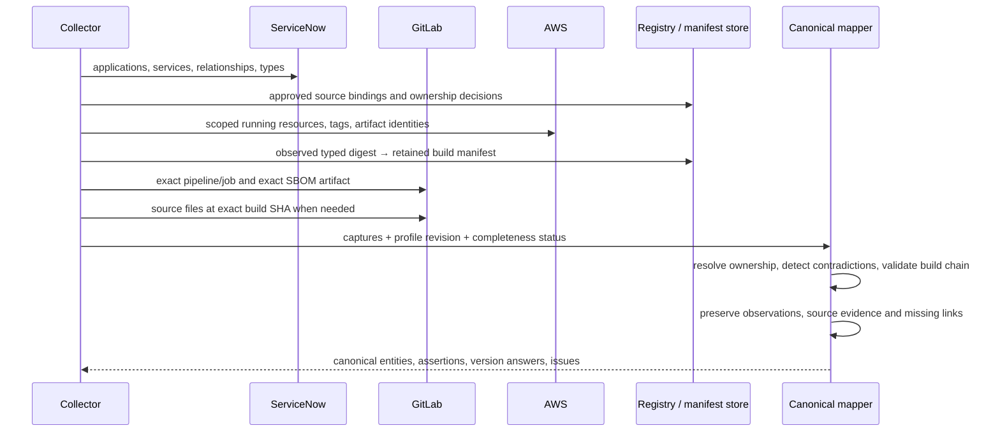

# Collect and connect the official APIs

The static POC consumes simulated captures. This runbook describes a production collector or controlled offline capture job; the code does not claim to have connected to customer endpoints. Keep credentials in the collector, and emit sanitized, provenance-bearing records to an access-controlled store. Public demo fixtures must remain fictional.

## 1. Establish scope and credentials

Record ServiceNow instance, GitLab base URL, AWS partition/accounts/regions, configured CMDB classes, relation type IDs/direction, approved service/source registry, allowed repository paths and environment aliases. Names alone cannot connect these sources.

- **ServiceNow:** use the instance's supported OAuth flow or configured service-account authentication. The identity needs table and field ACL read access to business applications, the selected application-service class, relationships, relationship types and approved custom mapping fields. Role names vary by instance/plugin; admin is not a universal prerequisite.
- **GitLab:** project/group/personal access token with `read_api` and sufficient project membership. `read_repository` can cover supported repository-file reads, but does not replace metadata/artifact permissions across the full flow. CI job tokens have endpoint/project restrictions. Artifact access restrictions still apply.
- **AWS:** use workload identity or a role assumed into each configured account, with read actions from [the API catalog](api-reference.md). Preserve account/region capture context. GetCallerIdentity identifies the selected principal/account. Avoid static access keys in the browser.

No credentials are committed by this POC. Example shell variables below are supplied in the collector's environment; do not enable shell tracing around secrets.

## 2. Collect ServiceNow ownership and service topology

Use the native Table API. Select raw reference values with `sysparm_display_value=false`; retain display text separately when needed. These field names are the demo profile, not universal customer requirements.

```bash
curl --fail-with-body --silent --show-error --get \
  --header "Authorization: Bearer $SN_ACCESS_TOKEN" \
  --data-urlencode 'sysparm_fields=sys_id,number,name,application_manager,business_criticality,sys_updated_on' \
  --data-urlencode 'sysparm_query=ORDERBYsys_id' \
  --data-urlencode 'sysparm_display_value=false' \
  --data-urlencode 'sysparm_limit=1000' --data-urlencode 'sysparm_offset=0' \
  "$SN_URL/api/now/table/cmdb_ci_business_app"

curl --fail-with-body --silent --show-error --get \
  --header "Authorization: Bearer $SN_ACCESS_TOKEN" \
  --data-urlencode 'sysparm_fields=sys_id,name,sys_class_name,u_deployable_service_id,u_environment,u_business_application,sys_updated_on' \
  --data-urlencode 'sysparm_display_value=false' \
  --data-urlencode 'sysparm_limit=1000' --data-urlencode 'sysparm_offset=0' \
  "$SN_URL/api/now/table/cmdb_ci_service_auto"

curl --fail-with-body --silent --show-error --get \
  --header "Authorization: Bearer $SN_ACCESS_TOKEN" \
  --data-urlencode "sysparm_query=type=$RELATION_TYPE_SYS_ID^parentIN$APPLICATION_SYS_IDS^ORDERBYsys_id" \
  --data-urlencode 'sysparm_fields=sys_id,parent,child,type,sys_updated_on' \
  --data-urlencode 'sysparm_display_value=false' \
  --data-urlencode 'sysparm_limit=1000' --data-urlencode 'sysparm_offset=0' \
  "$SN_URL/api/now/table/cmdb_rel_ci"

curl --fail-with-body --silent --show-error --get \
  --header "Authorization: Bearer $SN_ACCESS_TOKEN" \
  --data-urlencode "sysparm_query=sys_id=$RELATION_TYPE_SYS_ID" \
  --data-urlencode 'sysparm_fields=sys_id,name,parent_descriptor,child_descriptor' \
  "$SN_URL/api/now/table/cmdb_rel_type"
```

Supply validated instance-local IDs to the encoded queries. Follow all pages, handle ACL-filtered fields, and batch ID filters to stay within request limits. A renamed relation label does not change the relation sys_id. Discover and validate the actual relationship direction with the customer's CMDB model; do not assume every installation uses the sample relationship.

The approved service registry bridges application-service CIs to deployable services and GitLab project/path/build targets. It can be stored in a custom ServiceNow table, a catalog, or an integration registry. Preserve its provenance and effective dates. `u_gitlab_project_ids` is a legacy demo convenience, not the comprehensive mapping contract.

## 3. Observe AWS workloads and placement

Collect current resources independently of GitLab's desired deployment target. Use SDK pagination or the CLI's supported auto-pagination; do not process only the first page. Retain per-resource errors from batch responses.

```bash
aws sts get-caller-identity
aws ecs list-clusters --region "$AWS_REGION"
aws ecs describe-clusters --clusters "$CLUSTER_ARN" --region "$AWS_REGION"
aws ecs list-services --cluster "$CLUSTER_ARN" --region "$AWS_REGION"
aws ecs describe-services --cluster "$CLUSTER_ARN" --services "$SERVICE_ARN" --region "$AWS_REGION"
aws ecs list-tasks --cluster "$CLUSTER_ARN" --desired-status RUNNING --region "$AWS_REGION"
aws ecs describe-tasks --cluster "$CLUSTER_ARN" --tasks "$TASK_ARN" --include TAGS --region "$AWS_REGION"
aws ecs describe-task-definition --task-definition "$TASK_DEFINITION_ARN" --region "$AWS_REGION"
aws ecs list-tags-for-resource --resource-arn "$TASK_ARN" --region "$AWS_REGION"
aws ecr describe-images --registry-id "$AWS_ACCOUNT_ID" --repository-name "$ECR_REPOSITORY" \
  --image-ids imageDigest="$IMAGE_DIGEST" --region "$AWS_REGION"
```

For ECS, each running container is an observed workload. Retain task ARN, cluster ARN, `group`, task-definition revision, container name, image URI, observed `imageDigest`, state and time. `DescribeServices.taskDefinition` is desired state; tasks may still run another revision. The container digest is the artifact join key. ECR locates that digest but its mutable tags never replace a missing observation. An OCI index digest and platform-specific child digest require a verified descriptor relationship; the POC does not invent one.

```bash
aws lambda list-functions --region "$AWS_REGION"
aws lambda list-versions-by-function --function-name "$FUNCTION_NAME" --region "$AWS_REGION"
aws lambda list-aliases --function-name "$FUNCTION_NAME" --region "$AWS_REGION"
aws lambda get-alias --function-name "$FUNCTION_NAME" --name "$ALIAS_NAME" --region "$AWS_REGION"
aws lambda get-function --function-name "$FUNCTION_NAME" --qualifier "$FUNCTION_VERSION" --region "$AWS_REGION"
aws lambda list-tags --resource "$UNQUALIFIED_FUNCTION_ARN" --region "$AWS_REGION"
aws ec2 describe-instances --filters Name=instance-state-name,Values=running --region "$AWS_REGION"
aws ssm list-inventory-entries --instance-id "$INSTANCE_ID" --type-name AWS:Application --region "$AWS_REGION"
```

For Lambda, expand primary and weighted alias targets, then collect each qualified version. The fixture models published ZIP versions; `CodeSha256` is a base64 SHA-256 of code, not an ECR digest. `Runtime=python3.11` is a managed runtime family. Container-image Lambda needs `Code.ResolvedImageUri` and container identity handling; layers need their own versioned ARNs and code/artifact evidence. These extensions are documented in [coverage](coverage.md), not silently treated as implemented.

For EC2, preserve `Reservations.OwnerId` or independent collector account context plus region and instance ID. `AWS:Application` inventory needs SSM-managed nodes and configured inventory collection. Its `CaptureTime` can differ from workload capture. Installed packages are host evidence; application usage requires an additional process/workload association.

## 4. Resolve source/build identity in GitLab

The registry identifies the allowed GitLab instance/project/build target. The observed AWS digest/code hash must then resolve to a retained build-produced manifest. GitLab does not provide a universal AWS-digest-to-SBOM REST endpoint; this is an integration-owned bridge generated in CI.

```json
{
  "project_id": 101,
  "pipeline_id": 8003,
  "commit_sha": "<full-build-sha>",
  "sbom_job_id": 12003,
  "sbom_path": "sbom.cdx.json",
  "subject": {"type": "container-image", "digest": "sha256:<immutable-digest>"},
  "created_at": "<build-capture-time>"
}
```

Generate the manifest after obtaining the pushed image digest or ZIP hash, and bind it to the SBOM-producing job. Retain it independently of expiring CI artifacts. For production, include source instance, build target/path, content hash of the SBOM and suitable integrity/attestation controls; the POC validates metadata consistency, not cryptographic build attestations.

```bash
curl --fail-with-body --silent --show-error --header "PRIVATE-TOKEN: $GITLAB_TOKEN" \
  "$GITLAB_URL/api/v4/projects/$PROJECT_ID"
curl --fail-with-body --silent --show-error --header "PRIVATE-TOKEN: $GITLAB_TOKEN" \
  "$GITLAB_URL/api/v4/projects/$PROJECT_ID/pipelines/$PIPELINE_ID"
curl --fail-with-body --silent --show-error --header "PRIVATE-TOKEN: $GITLAB_TOKEN" \
  "$GITLAB_URL/api/v4/projects/$PROJECT_ID/jobs/$SBOM_JOB_ID"
curl --fail-with-body --silent --show-error --header "PRIVATE-TOKEN: $GITLAB_TOKEN" \
  "$GITLAB_URL/api/v4/projects/$PROJECT_ID/jobs/$SBOM_JOB_ID/artifacts/$ENCODED_SBOM_PATH" \
  --output captured-sbom.json
curl --fail-with-body --silent --show-error --header "PRIVATE-TOKEN: $GITLAB_TOKEN" \
  "$GITLAB_URL/api/v4/projects/$PROJECT_ID/environments?per_page=100"
curl --fail-with-body --silent --show-error --header "PRIVATE-TOKEN: $GITLAB_TOKEN" \
  "$GITLAB_URL/api/v4/projects/$PROJECT_ID/deployments?per_page=100"
```

Validate pipeline SHA, job commit, job pipeline ID, project context, manifest subject and exact SBOM job/path. Multiple manifests for one project/typed digest are ambiguous in the POC and require resolution. Follow pagination on environment/deployment lists; retain intended SHA and status. The latest successful deployment does not overwrite older running tasks during a rollout. Handle artifact redirects according to the client and credential policy; do not forward credentials to an untrusted redirect origin.

## 5. Repository fallback at the matching revision

If a version is absent from an SBOM or other metadata, enumerate `GET /projects/:id/repository/tree?ref=<full-build-sha>&recursive=true`, then read `GET /projects/:id/repository/files/<encoded-path>?ref=<same-sha>` or `/raw`. The [repository evidence guide](../repository-version-evidence.md#collect-source-files-using-official-gitlab-apis) contains concrete requests, field meanings, size/rate limits and parser support.

Preserve requested revision, file-last-change revision, blob/hash, path and locator. Resolve submodules separately at pinned revisions; do not use their default branches. Runtime pins, engine constraints, lockfile versions, build tools and image tags have different scopes. Unknown build identity permits source inspection but does not permit environment attribution.

## 6. Normalize, correlate, validate and retain



Record collection-run IDs, source/instance/API versions, scope, timestamps, completion state, pagination cursors and failures. Use bounded retries with exponential backoff and jitter for transient errors and 429 responses; respect `Retry-After`. Distinguish denied, not found, expired, unsupported, not collected and genuinely empty. For incremental collection, overlap update windows and reconcile deletes; stable ordering alone is not a transactional snapshot across three platforms.

Persist native evidence and canonical relationships together. Keep mapping-profile revisions so the result can be reproduced. The shipped CLI and SQLite importer demonstrate reproducible persistence for the simulated capture. The SQL schema is a single-export graph store; historical reconciliation and operational retention policies are production work.
