# complete logical ERD

Generated from the same catalog as the POC workbench. Each node is a typed canonical entity; its native scoped key is documented in the entity dictionary. Logical fields below project native attributes, capture metadata and relationship keys; *_key foreign keys are physically implemented by typed edges, not duplicated columns in the graph store. Optional fields such as source-file hashes remain absent when the capture does not supply them. The physical graph store is documented separately. Cardinalities describe a valid, complete relationship; missing captures produce issues rather than invented parents. Many-to-many links are represented as relationship assertions.

```mermaid
erDiagram
  APPLICATION {
    string id PK
    string sys_id
    string number
    string name
    json application_manager
    string business_criticality
  }
  APPLICATION_SERVICE {
    string id PK
    string sys_id
    string sys_class_name
    string name
    string service_key FK
    string environment_key FK
  }
  SERVICE {
    string id PK
    string name
    string registry_namespace
  }
  SOURCE_BINDING {
    string id PK
    string service_key FK
    string project_key FK
    string path
    string build_target
    string role
    datetime valid_from
    datetime valid_to
  }
  PROJECT {
    string id PK
    string gitlab_instance
    integer project_id
    string path_with_namespace
    string default_branch
  }
  COMMIT {
    string id PK
    string project_key FK
    string sha
  }
  SOURCE_FILE {
    string id PK
    string commit_key FK
    string path
    string content_hash
    string last_commit_id
  }
  PIPELINE {
    string id PK
    string project_key FK
    string commit_key FK
    integer pipeline_id
    string status
    datetime created_at
  }
  JOB {
    string id PK
    string pipeline_key FK
    integer job_id
    string name
    string stage
    string status
  }
  ARTIFACT {
    string id PK
    string subject_type
    string digest
    string release
  }
  SBOM {
    string id PK
    string job_key FK
    string path
    string format
    string document_version
  }
  COMPONENT {
    string id PK
    string sbom_key FK
    string reference
    string name
    string purl
  }
  OBSERVATION {
    string id PK
    string component
    string version
    string precision
    string scope
    string locator
    datetime captured_at
  }
  ENVIRONMENT {
    string id PK
    string organization
    string name
  }
  GITLAB_ENVIRONMENT {
    string id PK
    string project_key FK
    string environment_key FK
    integer environment_id
    string name
    string tier
  }
  DEPLOYMENT {
    string id PK
    string gitlab_environment_key FK
    string commit_key FK
    integer deployment_id
    string status
    datetime updated_at
  }
  ACCOUNT {
    string id PK
    string partition
    string account_id
    string collector_principal
  }
  REGION {
    string id PK
    string partition
    string region_name
  }
  CLUSTER {
    string id PK
    string cluster_arn
    string cluster_name
    string status
  }
  ECS_SERVICE {
    string id PK
    string cluster_key FK
    string task_definition_key FK
    string service_arn
    string service_name
    integer desired_count
  }
  TASK_DEFINITION {
    string id PK
    string task_definition_arn
    string family
    integer revision
    json container_definitions
  }
  ECR_IMAGE {
    string id PK
    string artifact_key FK
    string registry_id
    string region
    string repository_name
    string image_digest
    json image_tags
  }
  LAMBDA_FUNCTION {
    string id PK
    string unqualified_arn
    string function_name
  }
  LAMBDA_ALIAS {
    string id PK
    string function_key FK
    string alias_arn
    string name
    string primary_version
    json additional_version_weights
  }
  WORKLOAD {
    string id PK
    string account_key FK
    string region_key FK
    string application_service_key FK
    string artifact_key FK
    string resource_id
    string kind
    datetime observed_at
    string mapping_status
  }
  INVENTORY {
    string id PK
    string workload_key FK
    string type_name
    datetime captured_at
  }
  APPLICATION }o--o{ APPLICATION_SERVICE : "application_uses_service"
  APPLICATION_SERVICE }o--|| SERVICE : "service_instance"
  APPLICATION_SERVICE }o--|| ENVIRONMENT : "service_environment"
  SERVICE ||--o{ SOURCE_BINDING : "service_source"
  SOURCE_BINDING }o--|| PROJECT : "binding_project"
  PROJECT ||--o{ COMMIT : "project_commit"
  COMMIT ||--o{ SOURCE_FILE : "commit_file"
  SOURCE_FILE ||--o{ OBSERVATION : "file_observation"
  COMMIT ||--o{ PIPELINE : "commit_pipeline"
  PIPELINE ||--o{ JOB : "pipeline_job"
  JOB }o--o{ ARTIFACT : "job_artifact"
  JOB ||--o{ SBOM : "job_sbom"
  ARTIFACT }o--o{ SBOM : "artifact_sbom"
  SBOM ||--o{ COMPONENT : "sbom_component"
  COMPONENT ||--o{ OBSERVATION : "component_observation"
  COMPONENT }o--o{ COMPONENT : "component_dependency"
  PROJECT ||--o{ GITLAB_ENVIRONMENT : "project_environment"
  GITLAB_ENVIRONMENT }o--|| ENVIRONMENT : "environment_alias"
  GITLAB_ENVIRONMENT ||--o{ DEPLOYMENT : "environment_deployment"
  DEPLOYMENT }o--|| COMMIT : "deployment_commit"
  ACCOUNT ||--o{ WORKLOAD : "account_workload"
  REGION ||--o{ WORKLOAD : "region_workload"
  CLUSTER ||--o{ ECS_SERVICE : "cluster_service"
  ECS_SERVICE }o--|| TASK_DEFINITION : "ecs_desired_definition"
  CLUSTER ||--o{ WORKLOAD : "cluster_workload"
  ECS_SERVICE ||--o{ WORKLOAD : "ecs_service_workload"
  WORKLOAD }o--|| TASK_DEFINITION : "workload_definition"
  ECR_IMAGE }o--|| ARTIFACT : "registry_artifact"
  LAMBDA_FUNCTION ||--o{ WORKLOAD : "function_version"
  LAMBDA_FUNCTION ||--o{ LAMBDA_ALIAS : "function_alias"
  LAMBDA_ALIAS }o--o{ WORKLOAD : "alias_version"
  WORKLOAD }o--|| APPLICATION_SERVICE : "workload_service"
  WORKLOAD }o--|| ENVIRONMENT : "workload_environment"
  WORKLOAD }o--|| ARTIFACT : "workload_artifact"
  WORKLOAD ||--o{ INVENTORY : "workload_inventory"
  INVENTORY ||--o{ OBSERVATION : "inventory_observation"
  WORKLOAD ||--o{ OBSERVATION : "workload_observation"
```

| Relationship | From | To | Cardinality | Join policy | Rule |
| --- | --- | --- | --- | --- | --- |
| application_uses_service | application | application_service | many-to-many | Configured cmdb_rel_ci type/direction or reference field | MAP-02 |
| service_instance | application_service | service | many-to-one | Configured deployable-service key | MAP-03 |
| service_environment | application_service | environment | many-to-one | Configured environment field and aliases | MAP-04 |
| service_source | service | source_binding | one-to-many | Approved source registry membership | MAP-03 |
| binding_project | source_binding | project | many-to-one | Scoped GitLab instance/project ID | MAP-03 |
| project_commit | project | commit | one-to-many | Exact project and full commit SHA | BUILD-01 |
| commit_file | commit | source_file | one-to-many | Repository file at the requested commit | REPO-01 |
| file_observation | source_file | observation | one-to-many | Parser path and line/JSON pointer | REPO-01 |
| commit_pipeline | commit | pipeline | one-to-many | Pipeline.sha equals commit SHA | BUILD-01 |
| pipeline_job | pipeline | job | one-to-many | Job.pipeline.id and project context agree | BUILD-01 |
| job_artifact | job | artifact | many-to-many | Manifest binds build/job to typed subject | BUILD-02 |
| job_sbom | job | sbom | one-to-many | Exact job artifact path and captured body | SBOM-01 |
| artifact_sbom | artifact | sbom | many-to-many | Validated manifest; no latest-job lookup | SBOM-01 |
| sbom_component | sbom | component | one-to-many | Document-local component reference | SBOM-02 |
| component_observation | component | observation | one-to-many | Recorded version/purl, precision and scope | SBOM-02 |
| component_dependency | component | component | many-to-many | Document dependency reference; missing refs retained as issues | SBOM-02 |
| project_environment | project | gitlab_environment | one-to-many | Project-scoped environment ID | DEPLOY-01 |
| environment_alias | gitlab_environment | environment | many-to-one | Configured alias, not a name equality join | MAP-04 |
| environment_deployment | gitlab_environment | deployment | one-to-many | Deployment.environment.id | DEPLOY-01 |
| deployment_commit | deployment | commit | many-to-one | Deployment.sha; intent only | DEPLOY-01 |
| account_workload | account | workload | one-to-many | ARN or explicit collector account context | AWS-01 |
| region_workload | region | workload | one-to-many | ARN or explicit collector region context | AWS-01 |
| cluster_service | cluster | ecs_service | one-to-many | DescribeServices.clusterArn | AWS-02 |
| ecs_desired_definition | ecs_service | task_definition | many-to-one | Service.taskDefinition at capture time; desired state | AWS-02 |
| cluster_workload | cluster | workload | one-to-many | Task.clusterArn | AWS-02 |
| ecs_service_workload | ecs_service | workload | one-to-many | Task.group service name + cluster scoped service identity | AWS-02 |
| workload_definition | workload | task_definition | many-to-one | Task.taskDefinitionArn, including revision | AWS-02 |
| registry_artifact | ecr_image | artifact | many-to-one | Typed image manifest digest; location retained separately | AWS-03 |
| function_version | lambda_function | workload | one-to-many | Qualified function ARN and Configuration.Version | AWS-04 |
| function_alias | lambda_function | lambda_alias | one-to-many | Alias belongs to unqualified function ARN | AWS-04 |
| alias_version | lambda_alias | workload | many-to-many | Primary FunctionVersion and AdditionalVersionWeights; routing intent | AWS-04 |
| workload_service | workload | application_service | many-to-one | Unique configured AWS application-service tag and validated ownership | MAP-01 |
| workload_environment | workload | environment | many-to-one | Resolved CMDB/AWS environment agreement | MAP-04 |
| workload_artifact | workload | artifact | many-to-one | Observed imageDigest or CodeSha256; never image tag | BUILD-02 |
| workload_inventory | workload | inventory | one-to-many | Account/region/instance and collection time | AWS-05 |
| inventory_observation | inventory | observation | one-to-many | Installed package Name/Version | AWS-05 |
| workload_observation | workload | observation | one-to-many | Lambda runtime family or artifact/host observation | VERSION-01 |

