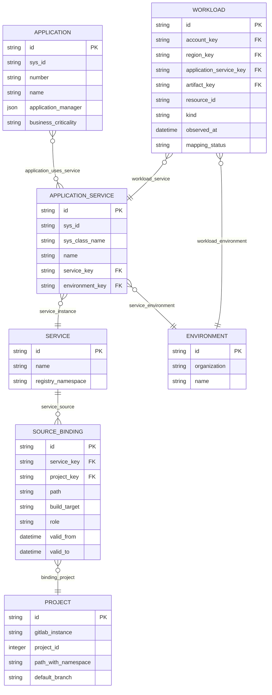

# ownership logical ERD

Generated from the same catalog as the POC workbench. Each node is a typed canonical entity; its native scoped key is documented in the entity dictionary. Logical fields below project native attributes, capture metadata and relationship keys; *_key foreign keys are physically implemented by typed edges, not duplicated columns in the graph store. Optional fields such as source-file hashes remain absent when the capture does not supply them. The physical graph store is documented separately. Cardinalities describe a valid, complete relationship; missing captures produce issues rather than invented parents. Many-to-many links are represented as relationship assertions.

| Relationship | From | To | Cardinality | Join policy | Rule |
| --- | --- | --- | --- | --- | --- |
| application_uses_service | application | application_service | many-to-many | Configured cmdb_rel_ci type/direction or reference field | MAP-02 |
| service_instance | application_service | service | many-to-one | Configured deployable-service key | MAP-03 |
| service_environment | application_service | environment | many-to-one | Configured environment field and aliases | MAP-04 |
| service_source | service | source_binding | one-to-many | Approved source registry membership | MAP-03 |
| binding_project | source_binding | project | many-to-one | Scoped GitLab instance/project ID | MAP-03 |
| workload_service | workload | application_service | many-to-one | Unique configured AWS application-service tag and validated ownership | MAP-01 |
| workload_environment | workload | environment | many-to-one | Resolved CMDB/AWS environment agreement | MAP-04 |

