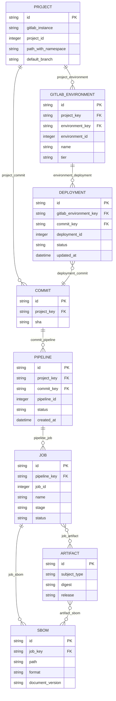

# delivery logical ERD

Generated from the same catalog as the POC workbench. Each node is a typed canonical entity; its native scoped key is documented in the entity dictionary. Logical fields below project native attributes, capture metadata and relationship keys; *_key foreign keys are physically implemented by typed edges, not duplicated columns in the graph store. Optional fields such as source-file hashes remain absent when the capture does not supply them. The physical graph store is documented separately. Cardinalities describe a valid, complete relationship; missing captures produce issues rather than invented parents. Many-to-many links are represented as relationship assertions.

| Relationship | From | To | Cardinality | Join policy | Rule |
| --- | --- | --- | --- | --- | --- |
| project_commit | project | commit | one-to-many | Exact project and full commit SHA | BUILD-01 |
| commit_pipeline | commit | pipeline | one-to-many | Pipeline.sha equals commit SHA | BUILD-01 |
| pipeline_job | pipeline | job | one-to-many | Job.pipeline.id and project context agree | BUILD-01 |
| job_artifact | job | artifact | many-to-many | Manifest binds build/job to typed subject | BUILD-02 |
| job_sbom | job | sbom | one-to-many | Exact job artifact path and captured body | SBOM-01 |
| artifact_sbom | artifact | sbom | many-to-many | Validated manifest; no latest-job lookup | SBOM-01 |
| project_environment | project | gitlab_environment | one-to-many | Project-scoped environment ID | DEPLOY-01 |
| environment_deployment | gitlab_environment | deployment | one-to-many | Deployment.environment.id | DEPLOY-01 |
| deployment_commit | deployment | commit | many-to-one | Deployment.sha; intent only | DEPLOY-01 |

