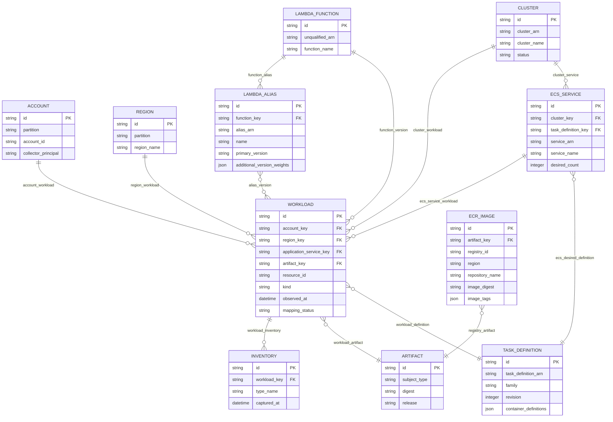

# runtime logical ERD

Generated from the same catalog as the POC workbench. Each node is a typed canonical entity; its native scoped key is documented in the entity dictionary. Logical fields below project native attributes, capture metadata and relationship keys; *_key foreign keys are physically implemented by typed edges, not duplicated columns in the graph store. Optional fields such as source-file hashes remain absent when the capture does not supply them. The physical graph store is documented separately. Cardinalities describe a valid, complete relationship; missing captures produce issues rather than invented parents. Many-to-many links are represented as relationship assertions.

| Relationship | From | To | Cardinality | Join policy | Rule |
| --- | --- | --- | --- | --- | --- |
| account_workload | account | workload | one-to-many | ARN or explicit collector account context | AWS-01 |
| region_workload | region | workload | one-to-many | ARN or explicit collector region context | AWS-01 |
| cluster_service | cluster | ecs_service | one-to-many | DescribeServices.clusterArn | AWS-02 |
| ecs_desired_definition | ecs_service | task_definition | many-to-one | Service.taskDefinition at capture time; desired state | AWS-02 |
| cluster_workload | cluster | workload | one-to-many | Task.clusterArn | AWS-02 |
| ecs_service_workload | ecs_service | workload | one-to-many | Task.group service name + cluster scoped service identity | AWS-02 |
| workload_definition | workload | task_definition | many-to-one | Task.taskDefinitionArn, including revision | AWS-02 |
| registry_artifact | ecr_image | artifact | many-to-one | Typed image manifest digest; location retained separately | AWS-03 |
| function_version | lambda_function | workload | one-to-many | Qualified function ARN and Configuration.Version | AWS-04 |
| function_alias | lambda_function | lambda_alias | one-to-many | Alias belongs to unqualified function ARN | AWS-04 |
| alias_version | lambda_alias | workload | many-to-many | Primary FunctionVersion and AdditionalVersionWeights; routing intent | AWS-04 |
| workload_artifact | workload | artifact | many-to-one | Observed imageDigest or CodeSha256; never image tag | BUILD-02 |
| workload_inventory | workload | inventory | one-to-many | Account/region/instance and collection time | AWS-05 |

