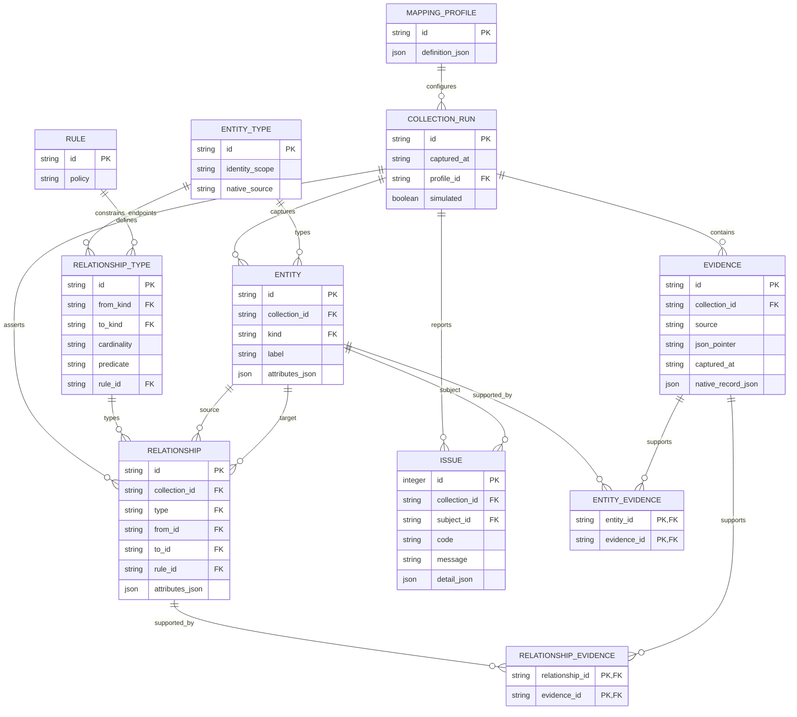

# Physical evidence graph: executable SQLite schema

The browser computes the canonical graph in memory. The CLI persists that same graph using [`schema/canonical-graph.sql`](../../schema/canonical-graph.sql). This is an implemented typed graph schema, not a claim that the logical ERD's 26 entities each have a separate SQL table. A typed `entity` row stores the domain entity's canonical key and attributes; `relationship` rows represent associations with explicit foreign keys, rule IDs and evidence.



The exported graph shape is also documented by [`schema/canonical-graph.schema.json`](../../schema/canonical-graph.schema.json), generated from the runtime catalog. JSON Schema defines the serialized types; SQL foreign keys and triggers enforce relational endpoints.

## Constraints and import behavior

- Canonical entity IDs include native identity scope. Relationship IDs encode type and both endpoints; accepted edges have unique `(collection,type,from,to)` identity.
- Foreign keys enforce entity types, rule references, relationship endpoints and evidence association. A trigger rejects endpoint-type and rule mismatches. JSON attributes/evidence must pass SQLite `json_valid`.
- Evidence is deduplicated by collection/source/JSON pointer. Native source payloads are persisted alongside the normalized attributes.
- A collection ID is a SHA-256 of the exact exported bundle. The database records its mapping profile and capture time. The importer creates a fresh database and refuses overwrite; errors roll back and remove the failed new output.
- This importer writes one capture per database. Entity IDs are globally unique within it. Multi-capture history requires a collection-qualified entity key or separate identity/observation tables and reconciliation; it is not implemented by appending exports to this schema.
- The schema validates graph structure, not source truth or complete cardinality semantics. Resolver tests enforce primary ownership/binding uniqueness. Source-level unknowns live in `issue`; accepted relationships must not point to invented/missing entities.

## Run it

```bash
node scripts/export-mapping.mjs /tmp/mapping.json cmdb-relationships
python3 scripts/build-mapping-db.py /tmp/mapping.json /tmp/mapping.sqlite
```

The CLI export includes native source bundles; the browser export is graph-only and is deliberately rejected by the database importer. The current importer accepts only the synthetic version-1 envelope, avoiding accidental mislabeling of production data.

## Example SQL: application to recorded workload versions

```sql
SELECT app.label AS business_application,
       svc.label AS application_service,
       json_extract(work.attributes_json, '$.environment') AS environment,
       work.label AS observed_workload,
       json_extract(obs.attributes_json, '$.component') AS component,
       json_extract(obs.attributes_json, '$.version') AS version,
       json_extract(obs.attributes_json, '$.precision') AS precision,
       json_extract(obs.attributes_json, '$.scope') AS evidence_scope
FROM entity app
JOIN relationship app_service ON app_service.from_id=app.id
  AND app_service.type='application_uses_service'
JOIN entity svc ON svc.id=app_service.to_id
JOIN relationship workload_service ON workload_service.to_id=svc.id
  AND workload_service.type='workload_service'
JOIN entity work ON work.id=workload_service.from_id
JOIN relationship workload_observation ON workload_observation.from_id=work.id
  AND workload_observation.type='workload_observation'
JOIN entity obs ON obs.id=workload_observation.to_id
WHERE app.kind='application'
ORDER BY app.label, environment, component;
```

This query deliberately includes all CMDB consumers of a shared service. The POC's primary application version view uses the approved operating-application decision instead. Include `precision` and `evidence_scope` in exports: Lambda family observations and EC2 installed software must not be described as exact executed application versions. Numeric threshold comparisons use the JavaScript conservative version comparator, not SQL lexicographic string comparison.

## Example SQL: inspect the raw evidence for one join

```sql
SELECT r.type, r.rule_id, e.source, e.json_pointer, e.native_record_json
FROM relationship r
JOIN relationship_evidence re ON re.relationship_id=r.id
JOIN evidence e ON e.id=re.evidence_id
WHERE r.type='workload_service';

PRAGMA foreign_key_check;
SELECT code, COUNT(*) FROM issue GROUP BY code;
```
