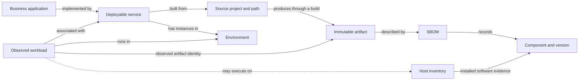

# Data mapping concepts

The question is: **For a business application, which language/runtime and library versions are associated with the workloads observed in each environment, and what evidence supports that answer?**

Real APIs provide the records, but an organization's fields, CMDB classes, tags, repository layout, and environment names determine how those records connect. Keep the business concepts stable while adapting their source representations.

This document defines the conceptual model and proposed integration principles. The current application is a fixed synthetic simulation. It does not yet implement configurable mapping profiles, live collectors, a persistent canonical store, or the full relationship model below. See [the adapter design](data-mapping-adapters.md) for the implementation boundary and [the simulation model](simulated-data-model.md) for today's exact fields.

## Conceptual chain

Each relationship needs its own evidence. A business-application tag can establish ownership or association; it cannot establish an installed library version. A GitLab deployment can establish intended state; the observed AWS artifact identifies which build is deployed. A host inventory can establish installed software; it cannot by itself identify the binary used by an application process.

## Stable concepts and variable representations

| Concept | Meaning | Common representations and differences |
| --- | --- | --- |
| Business application | Business-facing capability with ownership and lifecycle | ServiceNow business application CI, a local extension, or an approved catalog record |
| Deployable service | Independently built/deployed part of an application | ServiceNow application service/service instance, service catalog entry, GitLab project, or repository subdirectory |
| Source project | Code location and scoped identity | GitLab instance + project ID; a monorepo also needs path/component context |
| Build | A particular execution producing artifacts | Project + pipeline + job + commit; rerunning the same commit can produce different artifacts |
| Artifact | Immutable deployable software subject | Container manifest digest, Lambda ZIP code hash, package digest, or another typed release identifier |
| Deployment target | Intended release for a service/environment | GitLab environment/deployment, deployment controller, or infrastructure release record |
| Observed workload | Resource instance at an observation time | ECS task/container, qualified Lambda version, EC2 instance, or a future adapter's resource type |
| Environment | Organization-defined deployment context | Tags, service-instance relationships, GitLab environment, account/cluster placement, or approved mapping registry |
| Component observation | A package/runtime version asserted by a source | SBOM component, managed-runtime family, installed-software inventory, or future process measurement |
| Relationship assertion | Evidence that two identities are connected | Typed source reference, CMDB relationship, explicit tag, build manifest, or approved manual mapping |

These concepts do not require identical schemas at every organization. For example, `cmdb_ci_business_app`, `u_gitlab_project_ids`, and `BusinessApplicationId` are useful demo representations, not mandatory production field names.

## Relationships are not universally one-to-one

- One application can use many services; a shared service can support several applications.
- One repository can build several services or artifacts. Several repositories can contribute to one release.
- A service can have multiple workloads and versions in one environment during a rollout, canary, or regional deployment.
- A workload can contain several containers. A sidecar's SBOM must not be attributed to the application container.
- An artifact can be promoted across environments without rebuilding. Do not require a separate build per environment.
- An artifact can have several SBOMs, for example per architecture or scanner. Record their subjects and coverage; do not merge incompatible inventories silently.

Represent these as explicit relationships with scope and validity times. The current demo uses a simpler application-to-project list and resource tags; its single-application asset association and project-based matrix grouping do not implement all these cases.

## Identity rules

Use native immutable IDs scoped to their source instance. Names are labels and may change.

| Entity | Suggested scoped key |
| --- | --- |
| ServiceNow CI | Connector/instance ID + class/table + `sys_id` |
| GitLab project | GitLab instance ID + project ID |
| GitLab build/job | GitLab instance ID + project ID + pipeline/job ID |
| AWS workload | Partition + account + region + resource identity, plus container or function-version identity where applicable |
| Artifact | Subject type + digest algorithm/encoding + digest + required platform/registry context |
| SBOM | Capture identity + document identity/content digest + subject binding |
| Component | Ecosystem + namespace/name + exact recorded version + relevant qualifiers, preserving the original purl/reference |

An AWS instance ID or GitLab numeric project ID alone is not sufficient across organizations. A commit SHA identifies source content, not a reproducible artifact. A mutable image tag is a label, not an immutable subject.

Preserve the distinction between container index and platform-manifest digests. If a build manifest describes a multi-platform image index and a running container reports a platform-specific digest, resolve the index-to-manifest relationship explicitly. Never treat different digest strings as interchangeable. Lambda `CodeSha256` uses a different representation from the usual container `sha256:<hex>` string; retain the subject type and encoding.

## Environment mapping

Store both the raw environment value and the canonical environment identity, with the mapping rule that produced it. Scope rules to the organization and source context.

For one organization, `development`, `dev`, and `DEV` may mean the same environment. For another, `qa`, `test`, `stage`, and `uat` are separate stages. A GitLab deployment tier such as `testing` is a category and may include several distinct environments. An AWS account may host several environments.

Unknown values remain unmapped until an explicit policy resolves them. Do not use fuzzy matching to turn an unfamiliar environment into production. When authoritative sources disagree, preserve both assertions and flag the conflict rather than silently choosing a favorable result.

The demo currently has a fixed alias dictionary and a matrix displaying dev/UAT/prod. Production support for additional environments needs configurable identities and dynamic matrix columns.

## Association and evidence are separate decisions

Evaluate each edge independently:

1. **Application/service association:** identify the business application through a configured source relationship or approved mapping.
2. **Service/project association:** resolve the project and, if needed, repository path or build target.
3. **Workload/environment association:** retain resource identity, raw environment, canonical environment, and observation time.
4. **Observed artifact/build association:** match the observed typed artifact identity to the build's subject record.
5. **Artifact/SBOM association:** validate project, job, commit/build context, artifact path, and matching subject or attestation.
6. **Component observation:** retain the source version, version precision, coverage, and evidence scope before applying a version condition.

A failed association does not justify discarding the workload. Retain the known asset and expose the unresolved edge. Alternative mapping candidates may be shown for review, but should not establish an exact-version conclusion automatically.

## What an answer can claim

| Evidence | Supported conclusion | Limit |
| --- | --- | --- |
| Observed digest linked to an artifact SBOM | This observed artifact's inventory records component version X | Does not prove a process loaded or executed that component |
| Managed runtime configuration | The runtime family is, for example, Python 3.11 | Does not establish a patch version |
| Host installed-software inventory | Version X was recorded as installed on the host | Does not establish which application uses it |
| Deployment target only | The delivery system intends build Y for the environment | Does not establish current observed software |
| Missing/ambiguous mapping or incomplete collection | The requested fact is unknown | Must not become a passing compliance result or an absence claim |

“Exact” describes the precision of the recorded version and its subject association, not the completeness or authenticity of all source data. Treat mapping resolution, collection coverage, freshness, version precision, and evidence scope as separate dimensions rather than one unexplained confidence score.

A query should distinguish matches, comparable versions outside the condition, records that cannot be compared, and inventoried workloads with no matching component record. Include unresolved workloads in the coverage explanation.

## Time and conflicting observations

Record when the source observed the fact, when it was collected, and when it was normalized. Associate mappings with validity intervals where relationships change over time. Retain capture IDs so an answer can be reproduced.

An AWS observation of build A and a later GitLab deployment target of build B may describe a rollout or collection timing difference. Neither should overwrite the other. Present both timestamps and states. Stale inventory remains historical evidence and should not be presented as a current measurement. Define freshness limits by source and business context; there is no universal acceptable age.

## Worked conceptual example

Suppose an organization stores application `CUSTOMER-42` in a custom CMDB class, links it to a service through `cmdb_rel_ci`, and uses AWS tag `AppCode` instead of the demo's `BusinessApplicationId`.

A mapping profile resolves `CUSTOMER-42` to a scoped application identity and traverses the approved relationship to the service/project. A workload tagged `AppCode=CUSTOMER-42` and `Stage=acceptance` maps to that application and its UAT environment. Its observed container digest links to a build manifest and SBOM recording Python 3.11.10.

The conclusion comes from the same conceptual chain as the demo, even though the fields differ. If the workload only supplies `image:latest`, the application and environment can still resolve, but its exact runtime remains unknown until immutable artifact evidence or another suitable observation is available.

See [Data mapping adapters](data-mapping-adapters.md) for a proposed contract and onboarding workflow.
