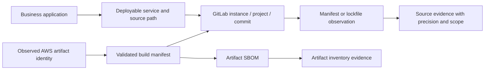

# Deriving versions from repository evidence

Repository analysis provides another evidence source when an SBOM, ServiceNow record, GitLab metadata, or AWS response omits a runtime or library version. It can answer **what a particular source revision declares or locks**, even when the deployed version remains unknown. A pinned value in source is useful evidence, but it is not proof that a build installed it or that a process uses it.

## Implemented in this proof of concept

Open **Repository evidence** in the public site. Choose a simulated GitLab commit, or select a checked-out local folder / individual manifest files. File contents are inspected in the browser, without uploads, code execution, dependency installation, external includes, or persistent storage. A folder selection reads the working tree, not Git history; its commit identity is unverified. Unsaved/uncommitted changes therefore cannot inherit the checkout's nominal commit.

Search a runtime or package with `=`, `≠`, `<`, `≤`, `>`, or `≥`. Results retain source file and line/JSON pointer, original version expression, precision, dependency scope, project, and commit. Threshold comparisons apply only to exact source versions in supported numeric formats. Constraints, families, hints, and unresolved references stay Unknown. “Any version” includes all evidence types without claiming that they meet a numeric threshold. Export the filtered findings, source context, notices, and linked assets as JSON.

The four generated samples cover a missing prod SBOM, a missing UAT NumPy version, Node/npm declarations plus lock entries, and an undeployed newer branch commit. Their API identities and file contents are fictional. Generate them with `npm run demo:generate`; `scripts/generate-repository-demo.mjs` resolves the existing fixture's build commits rather than inventing joins.

| File | Extracted evidence | Interpretation |
| --- | --- | --- |
| `.python-version`, `.node-version`, `.nvmrc`, `.ruby-version` | Runtime selections | Full numeric release = exact source pin; major/minor = family; aliases such as `lts/*` unresolved |
| `.tool-versions` | Recognized runtime selections | Preserve multiple selections; no tool-manager inheritance or plugin resolution |
| `package.json` | Dependencies, dev/optional/peer dependencies, engines | Full release declarations retained; partial/range dependencies and engine requirements do not establish resolved versions |
| `package-lock.json` v1–v3 | Resolved package versions, paths and dev/optional scope | Exact lock entries describe repository resolution; workspace links unresolved; no assertion that `npm ci` ran |
| `requirements*.txt` | Named requirements, `==` pins, ranges and markers | A numeric pin is exact source evidence; markers are retained but not evaluated; directives, continuations, hashes and includes are not resolved |
| `go.mod` | `go`, `toolchain`, and `require` declarations | Minimum/suggested toolchain or module requirements; actual toolchain/module selection can differ; replacement/exclusion notices |
| `Dockerfile`, `Dockerfile.*` | Recognized runtime image tags on `FROM` lines | Hints only: tags may move and stages may be build-only; no ARG, registry, image inheritance or final-image resolution |

Recognized but unsupported files (`pyproject.toml`, Poetry/uv/Pipenv locks, yarn/pnpm locks, Maven/Gradle, Cargo, Gemfile, Composer, .NET project/global configuration) produce notices. Other files are not read. There is no broad static code inference, full package-manager resolver, Git clone service, live API collector, or process scanner. No dependency ecosystem implies a particular runtime version.

Limits: 500 recognized files, 2 MB per file, 10 MB total. `.git`, `node_modules`, `vendor`, virtual environments and `.next` directories are excluded. Size/count/read/parse failures are visible notices. Tables show the first 200 filtered observations; exports include all filtered observations. An empty result never establishes absence.

## Correlation and confidence



Keep these axes separate:

- **Version precision:** exact, family, constraint, hint, unresolved.
- **Evidence scope:** source declaration, locked dependency, build tool, artifact inventory, host installed software, observed process.
- **Identity linkage:** unverified local selection, exact source revision, or revision linked through an observed artifact and validated build.
- **Coverage:** which paths/formats were inspected, and which were missing, denied, too large, or unsupported.

For example, `report-builder` prod's known AWS digest links to a build whose SBOM is missing. Its exact source commit has `.python-version = 3.11.9` and `pandas==2.1.4`. The repository view reports these pins and links back to the prod workload. The deployed-version search still reports Unknown because source pins do not replace the absent artifact inventory. UAT's missing NumPy SBOM version similarly has a separate `numpy==2.0.2` source observation. The newer branch's Python 3.13.0 pin has no observed deployment link.

A repeated build of one commit can resolve different dependencies, use a different base image, override runtime configuration, or exclude development dependencies. Preserve contradictory evidence, subdirectory boundaries, and source locations; do not choose the greatest version or automatically merge declarations into SBOM components. The POC lists such observations independently; it does not automatically adjudicate conflicts or assign confidence percentages.

`repositoryLinks()` accepts only captured GitLab-source context matching the asset's project and validated manifest commit. The existing portfolio validator supplies the application/project/digest/build provenance. It never joins local files or the latest branch by service name. The single-instance simulation uses numeric project IDs; a production adapter must also include GitLab instance identity, repository path/build target, capture time, and collection status.

## Collect source files using official GitLab APIs

Run collection server-side or as a controlled CLI job. Keep credentials out of the public static site. Use a project/group/personal access token with `read_api` and membership sufficient to read the repository and required build/job metadata; repository-file-only tokens can use `read_repository` where supported, but that does not grant the whole metadata workflow. Respect self-managed version differences and project policies.

First resolve the observed AWS digest/code hash through the validated build manifest, pipeline and job described in [the official API guide](official-api-integration-guide.md). This supplies **project ID and the full build commit SHA**. If that link is absent, collection can still analyze a user-selected revision, but must label its deployment association unresolved.

These are illustrative requests, with environment variables set by the collector. Project ID and commit are known values; the file path must be URL-encoded as a single path segment.

```bash
# Enumerate the tree of the exact commit. Follow every page.
curl --fail-with-body --silent --show-error --get \
  --header "PRIVATE-TOKEN: $GITLAB_TOKEN" \
  --dump-header tree.headers \
  --data-urlencode "ref=$BUILD_COMMIT_SHA" \
  --data-urlencode 'recursive=true' \
  --data-urlencode 'per_page=100' \
  --data-urlencode 'page=1' \
  "$GITLAB_URL/api/v4/projects/$PROJECT_ID/repository/tree" \
  --output tree-page.json

# Example path: services/report-builder/requirements.txt
# URL-encode the entire path, including slash characters.
ENCODED_FILE_PATH='services%2Freport-builder%2Frequirements.txt'
curl --fail-with-body --silent --show-error --get \
  --header "PRIVATE-TOKEN: $GITLAB_TOKEN" \
  --data-urlencode "ref=$BUILD_COMMIT_SHA" \
  "$GITLAB_URL/api/v4/projects/$PROJECT_ID/repository/files/$ENCODED_FILE_PATH" \
  --output repository-file.json

# Alternatively retrieve raw content at that SAME commit.
curl --fail-with-body --silent --show-error --get \
  --header "PRIVATE-TOKEN: $GITLAB_TOKEN" \
  --data-urlencode "ref=$BUILD_COMMIT_SHA" \
  "$GITLAB_URL/api/v4/projects/$PROJECT_ID/repository/files/$ENCODED_FILE_PATH/raw" \
  --output requirements.txt
```

For a production collector:

1. Enumerate with the immutable commit `ref` on every page. Follow returned `Link`/pagination headers until exhausted; support the selected GitLab version's pagination mode. Record incomplete enumeration, rate limits, 401/403, and 404 separately. Missing/denied files are not component absence.
2. Select approved paths and supported files from tree records (`path`, `type`, `mode`, blob `id`). Skip symlinks, submodules, generated/dependency folders, and unapproved paths. A submodule needs its own repository identity and pinned commit; do not replace it with its default branch.
3. Fetch files using the same commit. The metadata endpoint supplies `file_path`, `size`, `encoding`, `content`, `content_sha256`, `blob_id`, `commit_id`, and `last_commit_id`. Validate metadata, bound sizes before/after base64 decoding, and check content hashes where supplied. `last_commit_id` identifies the last change to that file, not the build revision; preserve it separately from the requested commit.
4. Preserve GitLab instance, project ID, requested/resolved commit, blob/hash, path, capture time, API result status, and parser version alongside observations. Cache by immutable project/commit/path identity. Honor documented large-file rate limits and `Retry-After`; retry transient failures with bounded backoff.
5. Feed `{path, content}` files and verified context into the analyzer. The current browser-local function can be reused in Node, but HTTP acquisition, token handling, pagination, evidence persistence and real-data UI integration remain collector work. Do not mark real captures as `simulated: true` or publish private source files in this demo's static fixtures.
6. Retain build-path mappings for monorepos and permitted inherited configuration. An app may have many repositories and one repository may build many services; project equality alone is insufficient to assign every extracted package to every service. A production collector must map the build context and retain any uncertainty.

Official references: [Repository tree API](https://docs.gitlab.com/api/repositories/#list-repository-tree), [Repository Files API and permissions](https://docs.gitlab.com/api/repository_files/), [REST pagination](https://docs.gitlab.com/api/rest/#pagination), [Commits API](https://docs.gitlab.com/api/commits/). The broader [integration guide](official-api-integration-guide.md) covers ServiceNow ownership/service relationships and AWS deployed-asset observation.

## Organization-specific mappings

The concepts stay stable even if ServiceNow uses a custom application class, source associations live in a mapping table, a GitLab monorepo has multiple build targets, or AWS uses account/cluster placement instead of environment tags. Extend the [adapter profile](data-mapping-adapters.md) with source roots, build contexts, allowed manifest paths, runtime-tool conventions, and provenance requirements. Never make a custom ServiceNow version field authoritative merely because the SBOM is incomplete: preserve its meaning, freshness, and source as another observation.

Tests in `repository-checks.mjs` verify extraction, conservative comparisons, precision, unsupported/malformed input, scope retention, resource limits, exact-commit links, and the rule that source fallback does not turn deployed Unknowns into matches.
